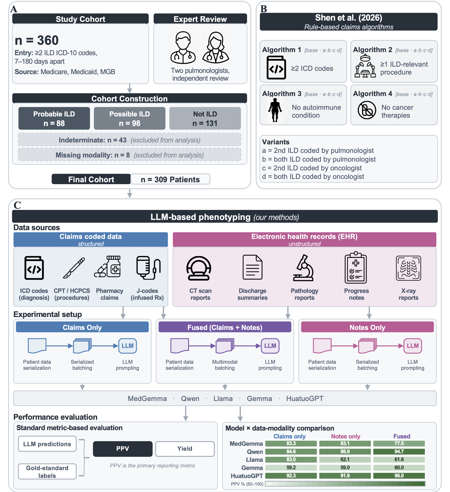

# ild-llm-phenotyping — Zero-shot LLM phenotyping of drug-induced interstitial lung disease

[](https://www.python.org/)
[](https://github.com/vllm-project/vllm)
[](LICENSE)

### Identifying interstitial lung disease with large language models on clinical notes and claims

Larghero G, Gu B, Anand P, Lin KJ, Schneeweiss S+, Yang J+.

*+Correspondence to Sebastian Schneeweiss and Jie Yang.*

#### ABSTRACT

Drug-induced interstitial lung disease (ILD) is a rare but sometimes fatal toxicity of immune checkpoint inhibitors and antibody-drug conjugates. Post-marketing surveillance depends on finding these cases in large healthcare databases, where manual chart review does not scale and hand-built rule-based algorithms trade the purity of the case series against the number of cases identified. We compared 12 open-weight large language models with 20 published claims-based algorithms on 309 expert-adjudicated oncology patients at Mass General Brigham, evaluating every method on the same patients using structured claims, clinical notes, or both. The models extended the positive predictive value (PPV)–yield frontier of the published algorithms under all three inputs, exceeding the most inclusive rule by 19.7 percentage points on average across the 36 model–input evaluations. Under non-differential outcome misclassification, detecting a hypothesised drug–ILD odds ratio of 3.0 at 80% power would require 591 patients with LLM phenotyping against approximately 27,200 with the strongest rule-based comparator.

<p align="center">
  
</p>

Code accompanying a study that used open-weight large language models to
identify interstitial lung disease (ILD) in cancer patients from clinical
notes and administrative claims, and compared them against 20 published
claims-based algorithms on a 309-patient adjudicated cohort. Thirteen models
were run through a single deterministic pipeline across three input
configurations (claims only, notes only, fused); twelve are in the reported
set.

> Citation: [PLACEHOLDER — paper citation to be added on publication]

## Data availability

The input data are protected health information and **cannot be distributed**.
No data are included in this repository and none of the pipeline can be run
as-is by a third party. The code is provided for transparency: to document
exactly how the cohort was built, how prompts were serialized, how inference
was run, and how every reported number was produced.

## Expected inputs

The pipeline expects these files (linked into `shared/data/` by `scaffold.sh`):

| File | Contents |
|---|---|
| `patient_windows/<patient_id>.json` | per-patient demographics, claims events (diagnoses, procedures, medications) and index date |
| `ehr_windowed_typed.parquet` | clinical notes: `Patient_Num_New`, `text_clean`, `UPDATE_DATE`, `note_type`, `ild_priority` |
| `window_stats.csv` | per-patient `patient_id`, `final_diagnosis`, `gold_label`, `has_ehr`, `cancer_group`, `age_at_index`, `n_ehr_notes` |
| `patient_drug_exposure.csv` | `Patient_Num` plus ILD-risk drug exposure |
| `ILD_01_EMPI_Final_Diagnosis_360.xlsx` | reference standard: `EMPI`, `Final_diagnosis`, and 19 `Algorithm_*` flag columns (published rules) |
| `df_dx_mapping.csv`, `df_px_mapping.csv` | ICD / CPT code-to-description maps |

Model weights are read from a local checkpoint directory (one subdirectory per
model, HuggingFace format).

## Pipeline

The pipeline is `s1` → `s2` → `s3` → `s4` → `s5`, gated by `v1`
(serialization), `v2` (inference) and `v3` (results):

1. `stages/s1_build_cohort.py` — build the 309-patient core cohort from the
   adjudicated 360.
2. `stages/s2_serialize.py --config {claims,notes,fused}` — render prompts;
   notes are paginated into batches costed under every model's tokenizer.
   Gate: `validate/v1_serialization.py` — every patient present, every batch
   fits every model's context, each note in exactly one batch, window bounds.
3. `stages/s3_infer.py --model M --config C` — the only GPU stage; vLLM with
   constrained JSON decoding, deterministic and resumable.
   Gate: `validate/v2_inference.py` — per cell: batch counts match
   serialization, no sentinel patients, labels in the closed set,
   probabilities valid, decoding parameters match `shared/config.py`.
4. `stages/s4_aggregate.py` — per-batch records → per-patient predictions.
5. `stages/s5_metrics.py` — per-cell metrics and the model × configuration
   grid (`results/grid_metrics.csv`).
   Gate: `validate/v3_results.py` — confusions sum to 309, gold labels match
   the reference standard, intervals bracket their points.

## Analysis scripts (`analysis/`)

All read `results/grid_metrics.csv` and the per-cell outputs; all CPU.

- `shen_evaluation.py` — the 20 published claims-based rules on the cohort.
- `frontier.py` — PPV–yield Pareto dominance of models vs the rule frontier.
- `power_projection.py` — Copeland misclassification / power model for every
  model × configuration and every rule.
- `decomposition.py` — claims/notes/fused modality decomposition and
  head-to-head McNemar tests against every rule.
- `aggregation_sweep.py` — alternative aggregation rules and probability /
  confidence threshold sweeps.
- `finegrained.py` — the note-tier ablation (plan, subcohorts, summary).
- `make_tables.py` — manuscript tables as LaTeX fragments.

## Environment variables

| Variable | Meaning | Default |
|---|---|---|
| `ILD_ROOT` | the repository checkout; overrides the auto-detected location | auto |
| `ILD_DATA_DIR` | input data directory, if not `shared/data/` | `shared/data/` |
| `ILD_MODEL_SHARE` | root directory of model checkpoints | `./models` |
| `ILD_DX_MAP`, `ILD_PX_MAP` | ICD / CPT mapping CSVs | under `ILD_DATA_DIR` |

To point the pipeline at your own data: set `ILD_ROOT` (or `ILD_DATA_DIR`) and
`ILD_MODEL_SHARE`, run `bash scaffold.sh`, then follow the pipeline order
above, running each gate before the next stage.

## Installation

```bash
conda env create -f environment.yaml
conda activate ild-llm
```

`environment.yaml` is the minimal environment: direct dependencies only, with
the versions actually used. `vllm` and `torch` are needed only for
`stages/s3_infer.py`; everything downstream runs on CPU.
